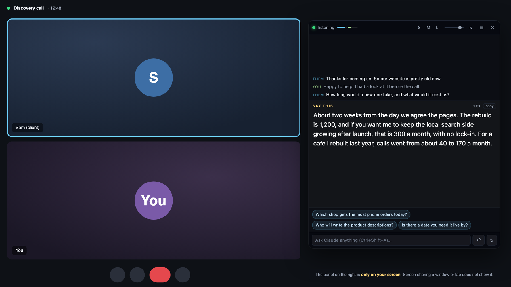
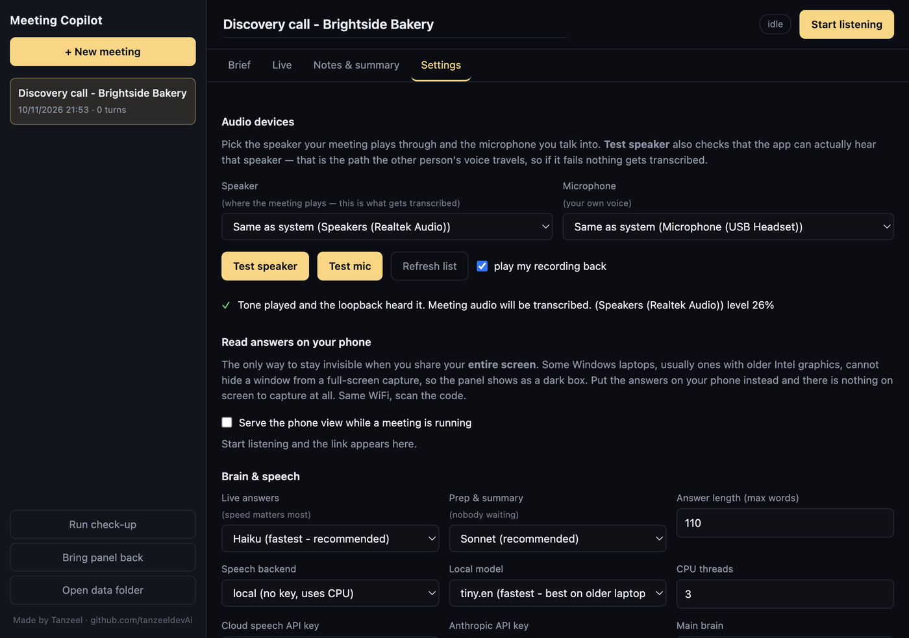
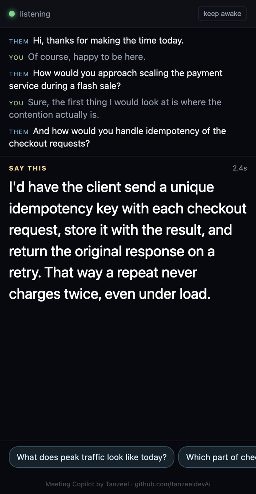

<div align="center">

# AI Meeting Assistant Copilot

**An open-source AI meeting assistant for Zoom, Google Meet and Teams. It listens to the call and writes what to say back on a private overlay that screen sharing does not show. Runs on the Claude or ChatGPT subscription you already have.**

[](https://github.com/tanzeeldevAi/ai-meeting-assistant-copilot/actions/workflows/tests.yml)
[](#install-on-windows)
[](#install-on-a-mac)
[](#which-ai-writes-the-answers)
[](#which-ai-writes-the-answers)
[](LICENSE)
[](https://github.com/tanzeeldevAi)



</div>

---

## What is this?

You are on a call with a client. They ask something, and you know the answer, but
putting it into clear words while they wait is the hard part. Maybe English is not
your first language, maybe it is a topic you only prepared last night.

Meeting Copilot sits on your screen during the call. It hears the other person,
understands the meeting from a short brief you write beforehand, and shows you
**what to say back**, a few seconds after they finish speaking. You read it,
put it in your own voice, and keep the conversation moving.

It is a free, open-source alternative to paid AI meeting copilots such as Cluely,
built for client calls, sales calls and consultations. It runs on your own
computer and uses the Claude or ChatGPT subscription you already pay for, so
there is no extra monthly fee and no API key needed.

## Features

- **Live answers.** Hears the other person, decides whether they asked something,
  and writes a reply in the first person, ready to say.
- **Hidden from screen sharing.** Share a window or a tab and the overlay is not in
  what the other side sees.
- **Answers *them*, never you.** Their voice comes from your speakers and yours from
  your microphone, so the two are never mixed up.
- **Follows your prepared script.** Paste your pitch, prices and talking points into
  the brief. When a question is covered, it gives you your own prepared line. When it
  is not, it answers only from your facts and will not invent experience, results or
  prices.
- **Private notes stay private.** Lines marked `NOTE - DON'T SAY` (your lowest price,
  a reminder to stop talking) guide the answers but are never shown as words to say.
- **"Ask Claude what else it needs."** Before the call it asks you the 4 to 6
  questions whose answers most improve the live answers.
- **Questions to ask next.** Three short suggestions that move the meeting toward
  your goal.
- **Type a question any time.** Ask it directly: "how do I say no politely?"
- **Read it on your phone instead.** A private page on your Wi-Fi shows the same
  answers on your phone, so nothing is on screen at all.
- **After the call.** Summary, decisions, action items and a ready follow-up
  message, exported to Word (.docx).
- **Works with Zoom, Google Meet, Microsoft Teams, Webex or any call app**, because it
  listens to your computer's sound, not to the app.
- **Speech to text on your own machine** by default. A faster cloud option is there
  if you want it.

<table>
  <tr>
    <td width="58%"></td>
    <td width="42%"></td>
  </tr>
  <tr>
    <td align="center"><sub>Prepare the meeting: who you are meeting, your goal, your script and prices.</sub></td>
    <td align="center"><sub>The same answers on your phone, for full-screen sharing.</sub></td>
  </tr>
</table>

---

## Which AI writes the answers

Pick whichever you already have. You can change it any time under
**Dashboard → Settings → Main brain**.

| | Claude | ChatGPT | OpenAI API |
|---|---|---|---|
| What you need | Claude Pro or Max | ChatGPT Plus, Pro or Business | An API key from platform.openai.com |
| Extra cost | None | None | Pay per use |
| How it connects | The Claude Code CLI, signed in | The Codex CLI, signed in with ChatGPT | The key, pasted into Settings |
| First words on screen | About 1 to 2 s after the question | About 7 to 9 s (the reply arrives whole) | About 1 to 2 s |
| Best for | Live answers | Prep and summaries; works live, but slower | A backup, or if you prefer the API |

Times are measured from the moment the question is sent, on a real account.
Speech to text adds its own time on top, see [Speed](#speed).

If Claude fails in the middle of a meeting (a usage limit, an expired login), the app
switches to a backup on its own and keeps answering: the OpenAI key if you set one,
otherwise ChatGPT if the Codex CLI is signed in.

---

## Before you start

You need three free programs. If you already have them, skip ahead.

| Program | Why | Get it |
|---|---|---|
| **Node.js** (version 18 or newer, the "LTS" one) | Runs the app | [nodejs.org](https://nodejs.org) |
| **Python** (3.10 to 3.12 recommended) | Listens and turns speech into text | [python.org](https://www.python.org/downloads/) |
| **Git** (optional) | Downloads this project | [git-scm.com](https://git-scm.com/downloads) |

On Windows, tick **"Add python.exe to PATH"** in the Python installer.

---

## Install on Windows

**Step 1. Download the project.** Either click the green **Code** button above and
choose **Download ZIP**, then unzip it, or run:

```bash
git clone https://github.com/tanzeeldevAi/ai-meeting-assistant-copilot.git
```

**Step 2. Run the setup.** Open the folder and double-click **`SETUP.bat`**. It
installs everything into the project folder and downloads the speech model (about
75 MB). It takes 5 to 10 minutes the first time and tells you if anything is missing.

**Step 3. Sign in to the AI.** Pick one, see [Sign in](#sign-in-to-the-ai-once).

**Step 4. Start it.** Double-click **`START.bat`**. Two windows open: the
**dashboard**, where you prepare and review, and the **overlay**, the panel you read
from during the call.

## Install on a Mac

**Step 1. Download the project**, the same way as above.

**Step 2. Run the setup.** Double-click **`SETUP-MAC.command`**. If macOS says it
cannot be opened, right-click it, choose **Open**, then **Open** again. It installs
everything into the project folder, builds the small helper that hears your Mac's
sound, and downloads the speech model. If it asks for Apple's developer tools, click
**Install**, wait for it to finish, and run the setup again.

**Step 3. Sign in to the AI.** See below.

**Step 4. Start it.** Double-click **`START.command`**. The first time, macOS asks for
two permissions. Allow both for **Electron**:

- **Microphone**, to hear you
- **Screen & System Audio Recording**, to hear the other person (no video is recorded)

If macOS offers **Quit & Reopen** after you allow it, quit, then double-click
`START.command` again.

---

## Sign in to the AI, once

### Claude (recommended for live answers)

1. Install Claude Code, if you do not have it:
   ```bash
   npm install -g @anthropic-ai/claude-code
   ```
2. Open a terminal, type `claude` and press Enter.
3. Inside it, type **`/login`** and finish the sign-in in your browser.

Only `/login` stores the sign-in. Opening `claude` alone can show a "Welcome back"
screen without a usable login.

### ChatGPT

1. Install the Codex CLI:
   ```bash
   npm install -g @openai/codex
   ```
2. Run:
   ```bash
   codex login
   ```
   and choose **Sign in with ChatGPT**.
3. In the dashboard, go to **Settings → Main brain** and pick **ChatGPT**.

### Check that it worked

Double-click **`CHECK.bat`** (Windows) or **`CHECK.command`** (Mac). It tells you
which AI is signed in, sends two real test questions and prints how fast each
answer came back.

---

## Your first meeting

**1. Before the call: write the brief.** In the dashboard, open **Brief** and fill in
who you are meeting, your role and what a good outcome looks like. Paste anything
the answers may draw on: your pitch, your prices, past results, your CV.

Use this format for a script, and the app follows it closely:

```text
1. PRICING
▶ SAY
"The rebuild is 1,200, and SEO after that is 300 a month, no lock-in."
NOTE - DON'T SAY
My floor is 1,000. Only offer it if they push twice.
```

Then press **Ask Claude what else it needs** and answer its questions. That minute
improves the live answers more than anything else.

Everything you type also helps the speech recognition: words from your brief, like
product names and jargon, come out spelled correctly.

**2. During the call: press Start listening.** The overlay shows:

- what they are saying, as it is transcribed
- **SAY THIS**, the suggested answer, appearing as it is written
- three questions you could ask next
- a box to ask the AI anything directly

**3. After the call: open Notes & summary.** Press **Generate summary** for a summary,
decisions, action items and a follow-up message, then **Download Word (.docx)**.


### Hotkeys

| Keys | What it does |
|---|---|
| `Ctrl` `Shift` `Space` | Show or hide the overlay |
| `Ctrl` `Shift` `H` | Hide it instantly |
| `Ctrl` `Shift` `X` | Click-through: the mouse passes through the overlay |
| `Ctrl` `Shift` `A` | Jump to the ask box |
| `Ctrl` `Shift` `R` | Write that answer again |

On a Mac these use the **Control** key. Drag the overlay from anywhere on it. **S / M
/ L** resize it and the slider sets how see-through it is.

### Choosing your speaker and microphone

**Dashboard → Settings → Audio devices**, the same idea as in Zoom. Both start on
**Same as system**, which follows your computer when you plug in headphones.

- **Test speaker** plays a short chime and reports whether the app could actually
  hear it. If the chime plays but the app hears nothing, the other person will not
  be transcribed, so this is the test that matters.
- **Test mic** records you for 4 seconds and tells you if you came through clearly.

---

## Screen sharing

**Share a window or a tab, not your entire screen.** Then the overlay is not part of
what the other side sees, on Windows and on Mac.

| What you share | Mac | Windows |
|---|---|---|
| A window or a browser tab | Hidden | Hidden |
| Your entire screen | Hidden on recent macOS | Hidden on most PCs; on some older graphics chips it shows as a dark box, never as readable text |

When you share your entire screen from Chrome on Windows (Google Meet, or Zoom and
Teams in the browser), the app notices and hides the overlay by itself. The desktop
Zoom and Teams apps do not announce a share the same way, so there, share a window. For complete peace of mind in any share mode, use the **phone view**:
Dashboard → Settings → Read answers on your phone, then scan the QR code with a phone
on the same Wi-Fi.

The measurements behind this are in [docs/SCREEN-SHARE.md](docs/SCREEN-SHARE.md).

---

## Speed

Two things take time after the other person stops talking: turning their speech into
text, and writing the answer.

| Speech to text | Words on screen, with Claude |
|---|---|
| Cloud (Deepgram, free tier available) | About 2 s |
| On your computer, modern laptop | About 3 to 4 s |
| On your computer, 2012 laptop | About 5 s |

Speech to text runs on your computer by default, with no account and no cost. For the
fastest answers, get a free key from [deepgram.com](https://deepgram.com) and set
**Settings → Speech backend → cloud**. If the connection drops mid-call it falls back
to your computer by itself.

On a newer machine, **Settings → Local model → base.en** is more accurate. Every
measurement is in [docs/BENCHMARKS.md](docs/BENCHMARKS.md).

---

## Privacy

- Your briefs, transcripts and settings are saved only on your computer, in the
  `data/` folder, which is never uploaded.
- Speech to text runs on your computer unless you choose the cloud option.
- The only thing that leaves your computer is what the AI needs to write an answer:
  the brief and the recent conversation, sent to Claude or ChatGPT under your own
  account.
- The phone view is a private link with a secret code in it, and only works on your own Wi-Fi.

**Use it responsibly.** In many places you must tell people before you transcribe a
call, and some workplaces, schools and exams do not allow assistants like this. Check
the rules that apply to you.

---

## Troubleshooting

<details>
<summary><b>Answers never appear</b></summary>

Run `CHECK.bat` or `CHECK.command`. It says whether the AI is signed in and prints the
exact fix. Most often: open a terminal, run `claude`, type `/login`, and finish in the
browser. For ChatGPT: run `codex login`.
</details>

<details>
<summary><b>"Python packages are missing" or the setup stops</b></summary>

Run the setup again, it picks up where it stopped. On Windows, make sure Python was
installed with **"Add python.exe to PATH"** ticked. Python 3.10, 3.11 or 3.12 is the
safest choice.
</details>

<details>
<summary><b>It hears me but not the other person</b></summary>

Use **Settings → Test speaker**. If it hears nothing, pick the device your call
actually plays through under **Speaker**. On a Mac, check that **Screen & System Audio
Recording** is allowed for Electron in System Settings → Privacy & Security.
</details>

<details>
<summary><b>"No speaker loopback found" (Windows)</b></summary>

Windows has no active output device. Plug in headphones or choose a speaker, then
press Stop and Start listening again.
</details>

<details>
<summary><b>It falls behind ("catching up")</b></summary>

Use the `tiny.en` local model, turn off **Show live partial text**, or switch the
speech backend to cloud.
</details>

<details>
<summary><b>The overlay is in the way</b></summary>

`Ctrl` `Shift` `X` lets the mouse pass through it. `Ctrl` `Shift` `H` hides it at once.
**Reset overlay** in the dashboard puts it back in the corner.
</details>

<details>
<summary><b>The Mac asks for permissions every time</b></summary>

Always start it with `START.command`, not from Terminal. Started from Terminal, macOS
gives the permissions to Terminal instead of to the app.
</details>

---

## How it works

```text
the other person ─► your speakers ─► system audio capture ─┐
                                                            ├─► voice detection ─► speech to text ─► AI ─► overlay
you ─────────────► your microphone ─────────────────────────┘                                          └─► phone
```

A small Python program captures the two sound sources separately, finds where
speech starts and stops, and turns it into text. The desktop app (Electron) decides
when the other person has finished a thought, sends the question to the AI with your
brief, and streams the answer to the overlay.

| Folder | What is in it |
|---|---|
| `audio/` | Capture, voice detection and speech to text (Python) |
| `audio/mac/` | The macOS system-audio helper (Swift, ScreenCaptureKit) |
| `src/main/` | The app: AI connections, meeting storage, Word export |
| `src/overlay/`, `src/dashboard/`, `src/companion/` | The overlay, the dashboard and the phone view |
| `test/` | Offline tests, run on every change on Windows and macOS |
| `tools/` | Live checks and measurements (see below) |
| `docs/` | Measurements: speed, screen sharing |

### Tests

```bash
npm test                                                    # app logic
.venv/bin/python3 -m unittest discover -s test -p "test_*.py"   # audio (Mac)
.venv\Scripts\python.exe -m unittest discover -s test -p "test_*.py"   # audio (Windows)
```

These need no microphone and no sign-in. Live checks that use your real AI
sign-in live in `tools/`: `test-script-mode.js` (follows the prepared script),
`test-private-notes.js` (private notes never leak) and `test-no-fabrication.js`
(never claims experience the brief does not mention).

---

## Contributing

Bug reports and pull requests are welcome. Please run the tests above first, and
describe how to reproduce any bug you report.

## License

MIT. See [LICENSE](LICENSE).

---

<div align="center">
<sub>Made by <a href="https://github.com/tanzeeldevAi">Tanzeel</a> · If it helps you on a call, a ⭐ helps others find it.</sub>
<br><br>
<sub>AI meeting assistant · meeting copilot · real-time meeting assistant · AI note taker · Zoom AI assistant · Google Meet AI assistant · Microsoft Teams · live transcription · Whisper speech to text · Claude · ChatGPT · Codex CLI · open-source Cluely alternative · Electron desktop app for Windows and macOS</sub>
</div>
